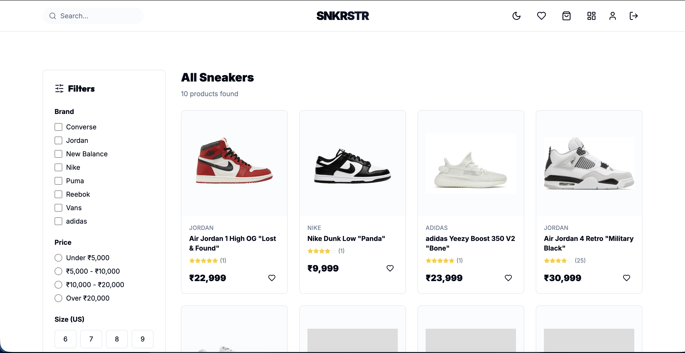
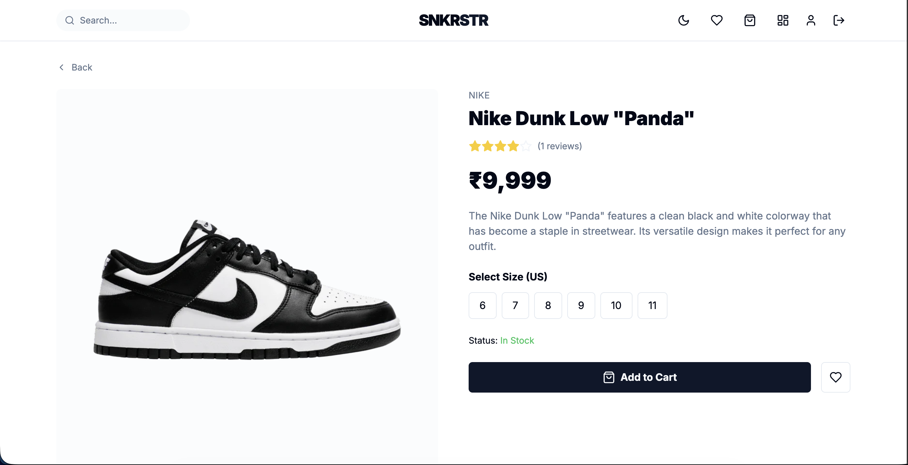
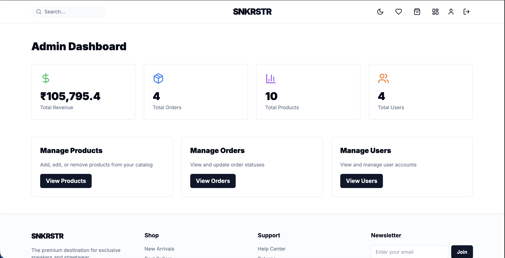

# SNKRSTR - Premium Sneaker E-Commerce Store

A full-stack, production-ready sneaker e-commerce platform built with the MERN stack (MongoDB, Express.js, React, Node.js).

 

## 🚀 Features

### User Features
- **Authentication**: Email/password login and registration with JWT
- **Product Browsing**: Dynamic filters (brand, price, size) powered by database data and real-time search
- **Product Details**: Image gallery, size selector, reviews & ratings
- **Shopping Cart**: Persistent cart with localStorage and database sync
- **Wishlist**: Save favorite products
- **Checkout**: PayPal integration (Live + Sandbox)
- **Order Tracking**: View order history and status
- **Profile Management**: Update account details



### Admin Features
- **Dashboard**: Revenue analytics, order stats, and insights
- **Product Management**: Create, edit, delete products with Cloudinary image upload
- **Order Management**: Update order statuses (processing → delivered)
- **User Management**: View and manage user accounts



### Design & UX
- **Dark/Light Mode**: Toggle between themes
- **Responsive**: Mobile-first design with smooth animations
- **Premium Fonts**: Inter + Satoshi (Google Fonts)
- **Micro-interactions**: Framer Motion animations

## 🛠️ Tech Stack

### Frontend
- **React** (Vite) - Fast, modern build tool
- **React Router v6.4+** - Client-side routing
- **Zustand** - Lightweight state management
- **TanStack Query v5** - Server state management
- **React Hook Form + Zod** - Form validation
- **Tailwind CSS** - Utility-first styling
- **Framer Motion** - Smooth animations
- **Lucide React** - Icon library
- **React Helmet Async** - SEO management
- **React Hot Toast** - Toast notifications
- **PayPal React SDK** - Payment integration

### Backend
- **Node.js + Express** - REST API
- **MongoDB + Mongoose** - Database
- **JWT** - Authentication (httpOnly cookies)
- **bcrypt** - Password hashing
- **Cloudinary** - Image hosting
- **Helmet** - Security headers
- **Cors** - Cross-origin resource sharing
- **Zod** - Schema validation

## 📦 Installation

### Prerequisites
- Node.js (v18+)
- MongoDB (local or Atlas)
- Cloudinary account
- PayPal developer account

### 1. Clone the repository
```bash
git clone https://github.com/akritij121/SneakVault.git
cd sneakerStore
```

### 2. Backend Setup
```bash
cd backend
npm install
```

Create `.env` file:
```env
NODE_ENV=development
PORT=8000
MONGO_URI=your_mongodb_connection_string
JWT_SECRET=your_secret_key
PAYPAL_CLIENT_ID=your_paypal_client_id
CLOUDINARY_CLOUD_NAME=your_cloud_name
CLOUDINARY_API_KEY=your_api_key
CLOUDINARY_API_SECRET=your_api_secret
```

Seed the database:
```bash
npm run data:import
```

Start backend server:
```bash
npm run server
```

### 3. Frontend Setup
```bash
cd frontend
npm install
npm run dev
```

Frontend will run on `http://localhost:5173`


## 📄 License

MIT License - feel free to use this project for learning or commercial purposes.

## 🙏 Acknowledgments

- Design inspiration: Supreme, StockX, GOAT
- Icons: Lucide React
- Fonts: Google Fonts
